<h2 id="restir">01ReSTIR · SPMIS</h2>

腾讯引擎开发实习 · 2026.06 - 2026.09

在 RTXDI 框架中复现 Stochastic Pairwise MIS（SPMIS）空间重采样，并构建等样本、等半径的对照评测。从 GRIS 的理论出发分析样本复用的有效性，再借助 Compatibility-Guided Neighbor Selection（CGNS）筛选复用 cell，最后将方法迁移至 ReSTIR GI。

  
<strong>35.7%</strong>
DI 的 MAPE 降低 <small>SPMIS 相比 Pairwise</small>

  
<strong>8.4%</strong>
DI 的 MAPE 进一步降低 <small>SPMIS + CGNS 相比 SPMIS</small>

  
<strong>15.1%</strong>
GI 的 MAPE 累计降低 <small>SPMIS + CGNS 相比 Pairwise</small>

### Direct Illumination 复现

在相同样本数和复用半径下，对比 Pairwise 与 SPMIS 的噪声和误差。通过共享 cell 中的候选样本，验证 SPMIS 空间重采样的效果，而不是通过增加样本预算获得收益。

<figure class="evidence-figure">
  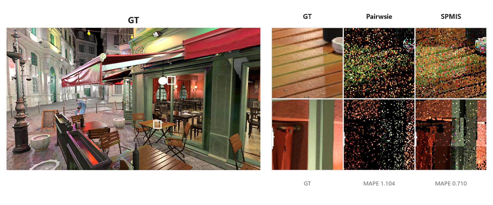
  <figcaption>DI / Pairwise → SPMIS</figcaption>
</figure>

### Compatibility-Guided 优化

复用样本经过 Shift Mapping 后，可能因为像素间几何差异失效。基于 GRIS 的理论基础，分析发现如果能尽量保证 Shift Mapping 前后的样本一致性，就能获得更好的结果。利用 CGNS 的兼容性启发式筛选复用 cell，就能很好地保证 Shift Mapping 前后的样本一致性，减少无效复用带来的方差。

<figure class="evidence-figure">
  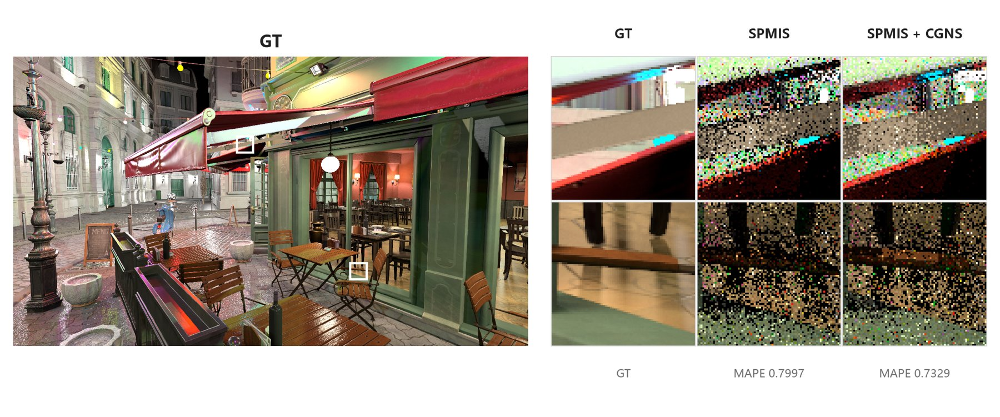
  <figcaption>DI / SPMIS → SPMIS + CGNS</figcaption>
</figure>

### Global Illumination 迁移

将 SPMIS 与 CGNS 从直接光重采样迁移到 ReSTIR GI，并沿用对照评测验证间接光的噪声与误差变化。下图展示室内场景中灯具及局部反射区域的结果。

<figure class="evidence-figure">
  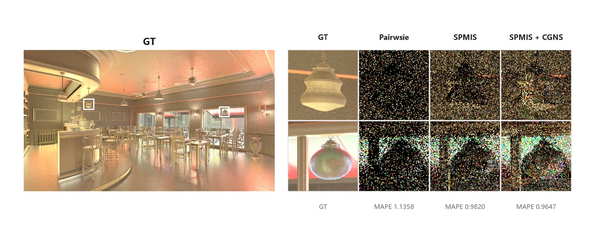
  <figcaption>GI / Pairwise → SPMIS → SPMIS + CGNS</figcaption>
</figure>

<h2 id="neural-bvh">02Neural BVH</h2>

腾讯引擎开发实习 · 2026.05 - 2026.06

将论文原本基于 CUDA 的光追框架改造成基于 OptiX 的硬件光追版本，建立纯硬件求交的对照基线。针对首版神经求交在性能与画质上均不及纯硬件的问题，从求交精度和 Divergence 两方面分析瓶颈，将方案调整为主光线走硬件、仅在次级光线上对部分表面使用神经求交。

### 性能收益的上限

神经 AABB 候选收集不能像三角交点查询一样，利用已知最近命中的距离持续缩短遍历范围。分段计时显示，神经方案仅硬件遍历 BVH 的部分就已耗时 **1.5 ms**，与纯硬件完整求交的 **1.4 ms** 基本相当。

<figure class="evidence-figure">
  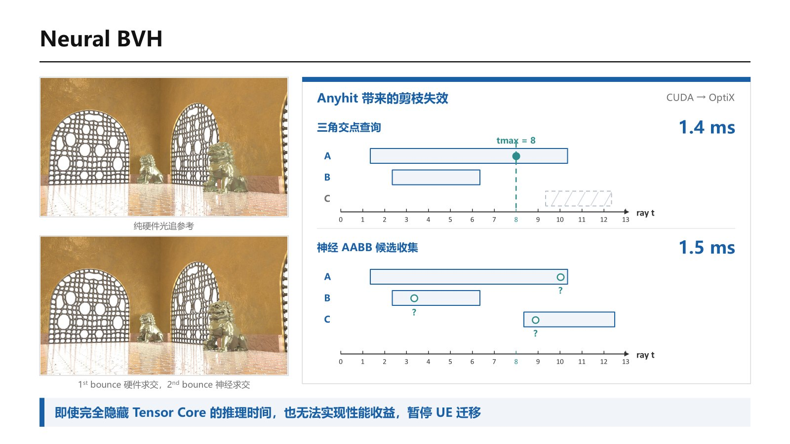
</figure>

<h2 id="myvk">03MyVK</h2>

个人项目 · 2025.11 — 2026.04

基于 Vulkan API 从零实现实时渲染器，覆盖光照与阴影、资源绑定、可见性剔除等功能，并围绕实际画面问题与 GPU 开销进行优化。

### Tiled Light Culling

若每个片元都遍历全部光源，着色开销会随光源数量膨胀。为此用 Compute Shader 预先构建各屏幕分块（Tile）的有效光源列表，片元着色阶段只遍历所在 Tile 的光源，减少无效光照计算。

<figure>
  <video controls preload="metadata" playsinline>
    <source src="./assets/myvk-light-culling.mp4" type="video/mp4">
  </video>
  <figcaption>Light Culling 测试场景：48 块平面，每块带有 25 个 Sphere Light</figcaption>
</figure>

相机沿动画路径移动，视野内光源数量从少量增加到全部，用于观察不同负载下的性能变化。

  <figure>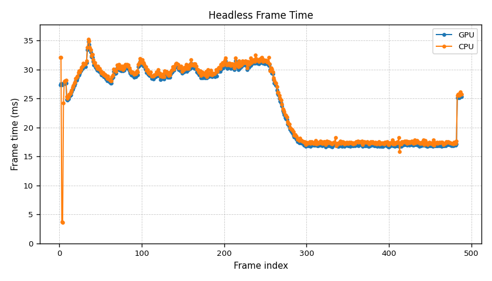<figcaption>关闭 Light Culling</figcaption></figure>
  <figure>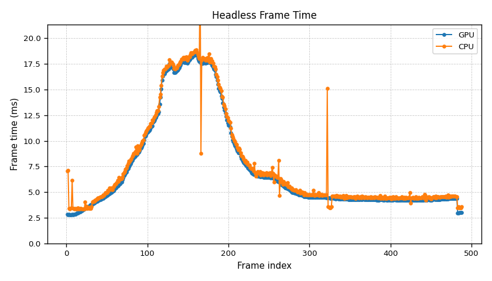<figcaption>开启 Light Culling</figcaption></figure>

特性开关对照中，峰值 frame time 接近减半；视野内光源较少时最低可降至未开启时的约十分之一。测试场景下获得约 <strong>2 — 10 倍</strong>性能提升。

### PCSS

Spot Light 与 Sphere Light 的阴影采用 PCSS：先通过 Blocker Search 估计遮挡体平均深度，再估算半影宽度，最后自适应调整 PCF 采样核。Blocker Search 与 PCF Filtering 均使用 20 次采样。

<figure>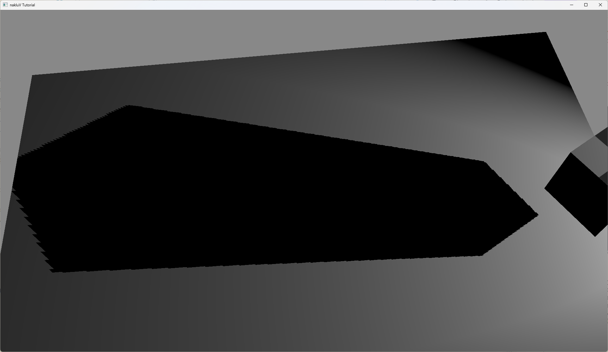<figcaption>无滤波 / 阴影边缘过硬</figcaption></figure>
<figure>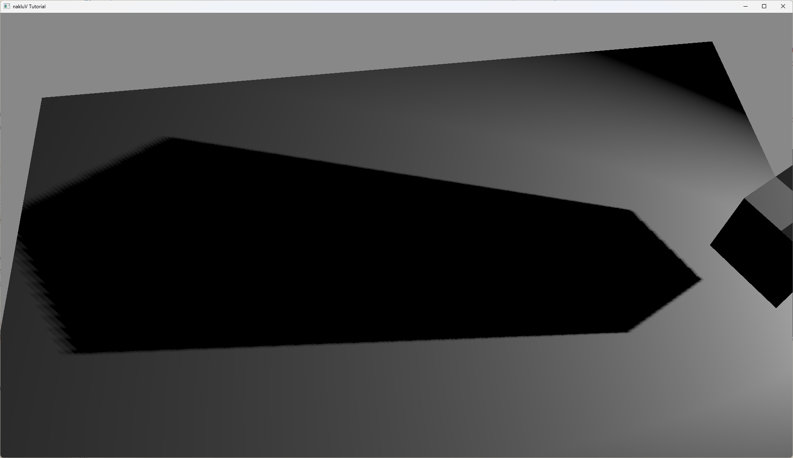<figcaption>PCF / 统一模糊阴影边缘</figcaption></figure>
<figure>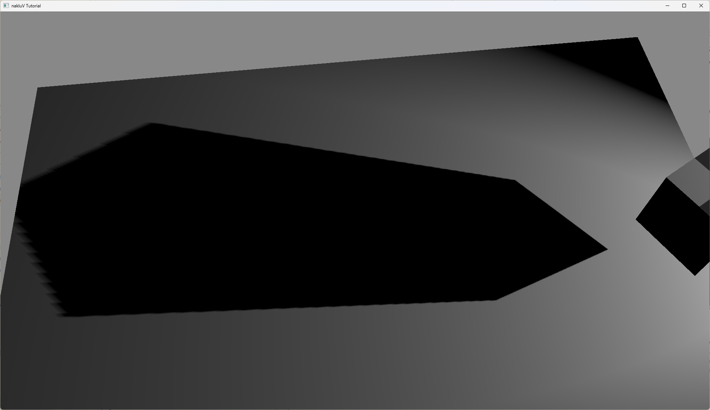<figcaption>PCSS / 近处更锐利，远处更柔和</figcaption></figure>

### Cascaded Shadow Map

Sun Light 使用 4 级 CSM。针对相机旋转引起的投影包围盒尺寸变化，以视锥体的外接包围球固定正交投影尺寸；针对相机平移产生的亚像素抖动，通过 Texel Snapping 将光源投影位移吸附到整数纹理像素步长。同时在相邻级联的交界处混合采样，平滑级联切换，并借助 RenderDoc 可视化验证。

<figure><video controls preload="metadata" playsinline><source src="./assets/myvk-cascade.mp4" type="video/mp4"></video><figcaption>相机运动时的级联过渡</figcaption></figure>
<figure><video controls preload="metadata" playsinline><source src="./assets/myvk-cascade-debug.mp4" type="video/mp4"></video><figcaption>Debug 视图 / Cascade 层级选择</figcaption></figure>

### PBR + IBL

基于 Karis Split-Sum 近似实现 IBL 预积分流程，包括 Diffuse Irradiance、Specular Prefilter 与 BRDF LUT。针对 GGX 重要性采样在高频区域产生的 Firefly，按样本的 Solid Angle 动态选择环境贴图 Mip 层级，抑制预滤波噪声。

<figure><video controls preload="metadata" playsinline><source src="./assets/myvk-pbr.mp4" type="video/mp4"></video><figcaption>PBR 着色管线</figcaption></figure>
<figure class="figure-compact"><figcaption>左侧为 Diffuse 项，后续为不同 Roughness 下的 Specular 项</figcaption></figure>

### Frustum Culling

基于相机 Frustum 与物体 AABB / OBB 进行相交测试，提前剔除视锥外几何体，减少 CPU Draw Call 提交与 GPU 无效开销。

<figure><video controls preload="metadata" playsinline><source src="./assets/myvk-culling.mp4" type="video/mp4"></video><figcaption>黄色：Frustum · 绿色：AABB · 蓝色：OBB · 红色：被剔除几何体</figcaption></figure>

### Bindless Texture

将逐材质纹理绑定改为动态纹理数组，通过 Push Constant 传递材质索引，在着色阶段按索引访问纹理，降低 descriptor 切换频率。


layout(set=2, binding=1) uniform sampler2D Textures[];

layout(push_constant) uniform Push {
    uint MATERIAL_INDEX;
} push;


<h2 id="mypt">04MyPT</h2>

个人项目 · 2025.03 — 2025.10

基于现代 C++ 实现离线渲染系统，围绕 NEE、MIS 与 Photon Mapping 进行可验证实验，以 PBRT v3 的参考图像检验渲染结果。

### 架构搭建

<figure>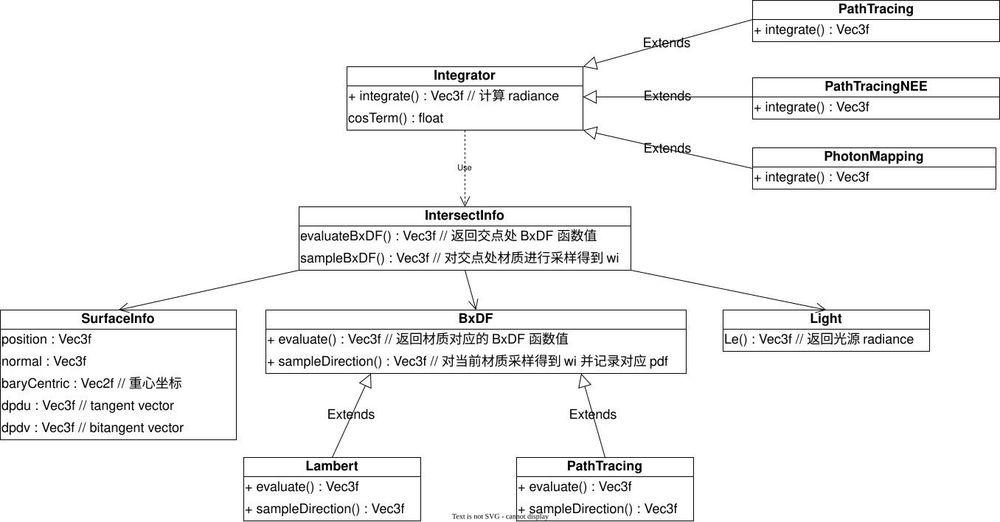<figcaption>渲染系统架构 / 参考 PBRT v3</figcaption></figure>

### NEE + MIS

朴素路径追踪在漫反射表面依赖 BRDF 余弦采样，难以命中小光源，容易产生大量零贡献样本。引入 NEE 显式采样光源，再以 Balance Heuristic 按概率密度融合光源采样与 BRDF 采样，使两种策略互补。

  <figure>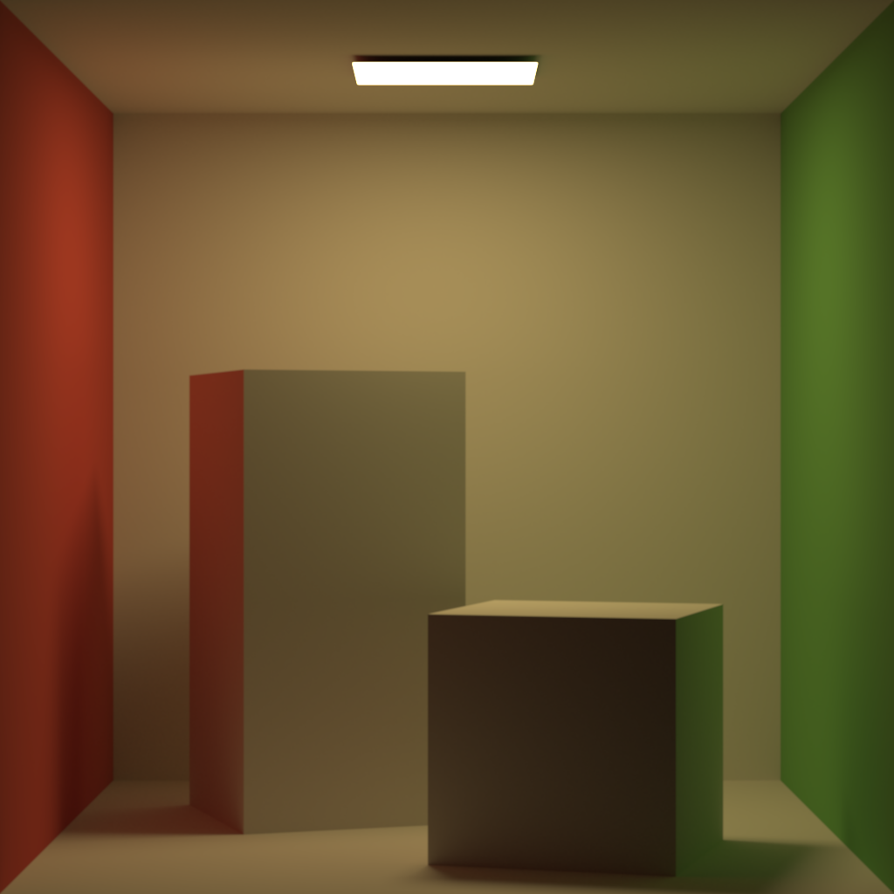<figcaption><strong>Ground Truth</strong>PBRT v3</figcaption></figure>
  <figure>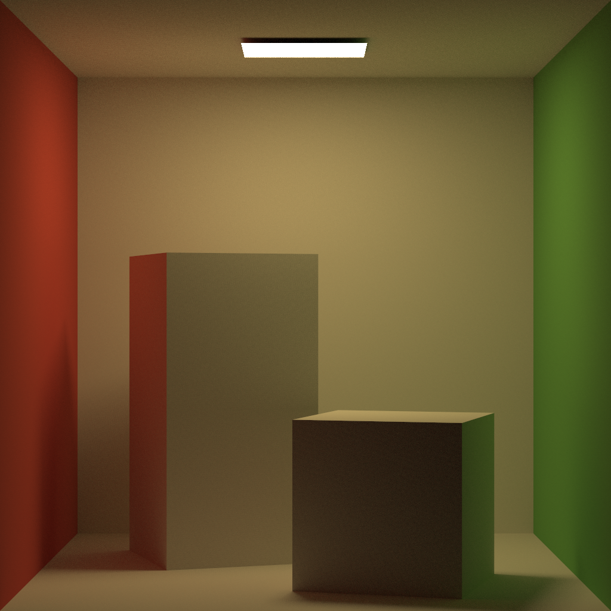<figcaption><strong>NEE + MIS</strong>256 spp · relMSE 0.0028</figcaption></figure>
  <figure>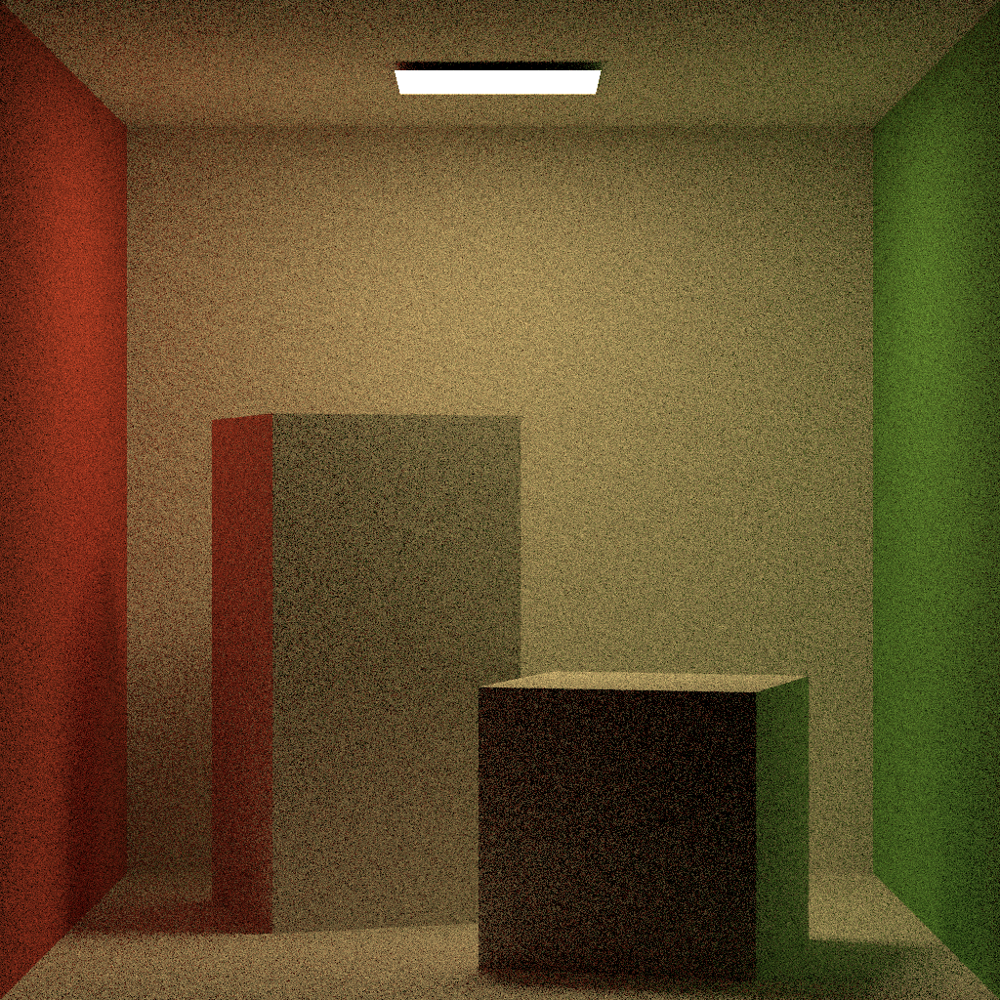<figcaption><strong>朴素 Path Tracing</strong>256 spp · relMSE 0.1613</figcaption></figure>

相同采样预算下，relMSE 降低 <strong>98.26%</strong>。

### Photon Mapping

镜面聚焦产生的焦散属于高频光路，朴素路径追踪难以有效采到。实现两趟 Photon Mapping：从光源发射光子，分别构建全局光子图与焦散光子图；渲染时在漫反射表面做密度估计，以 K 近邻确定自适应核半径，缓解光子疏密不均时的噪点与模糊。

  <figure>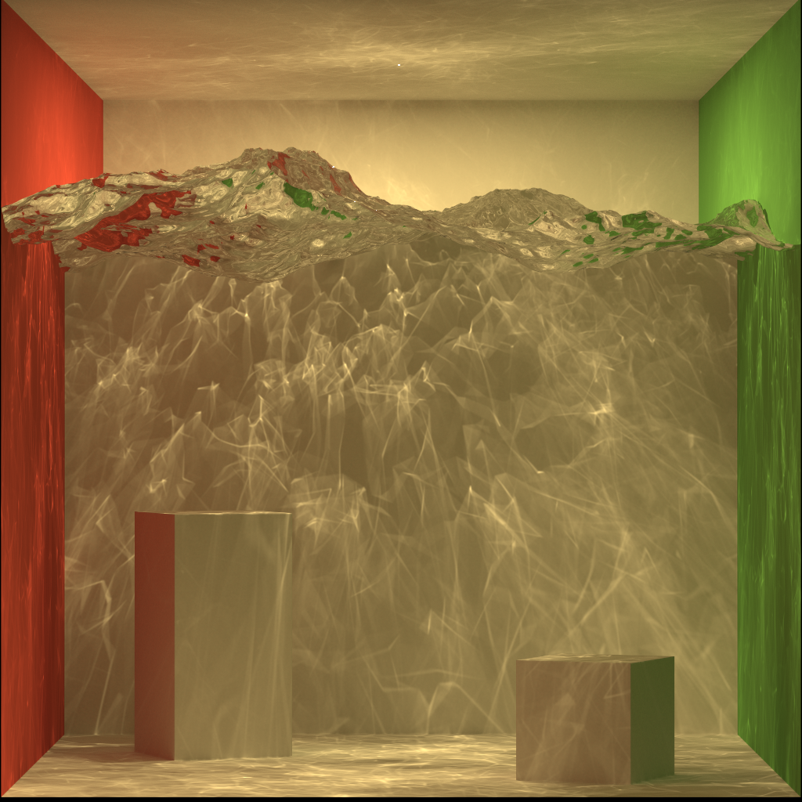<figcaption><strong>Ground Truth</strong>PBRT v3 · SPPM</figcaption></figure>
  <figure>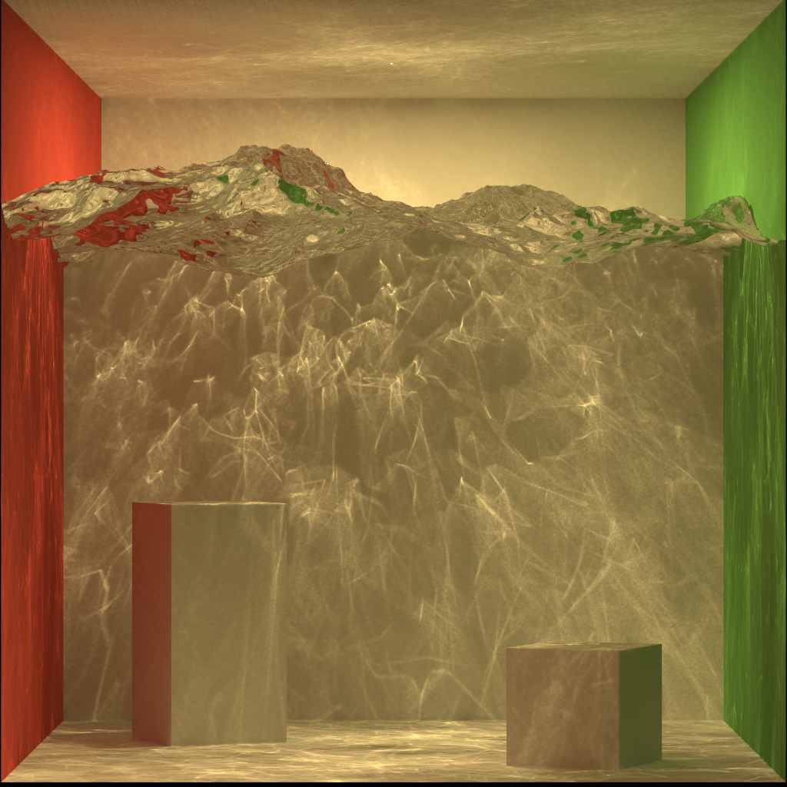<figcaption><strong>Photon Mapping</strong>20 min</figcaption></figure>
  <figure>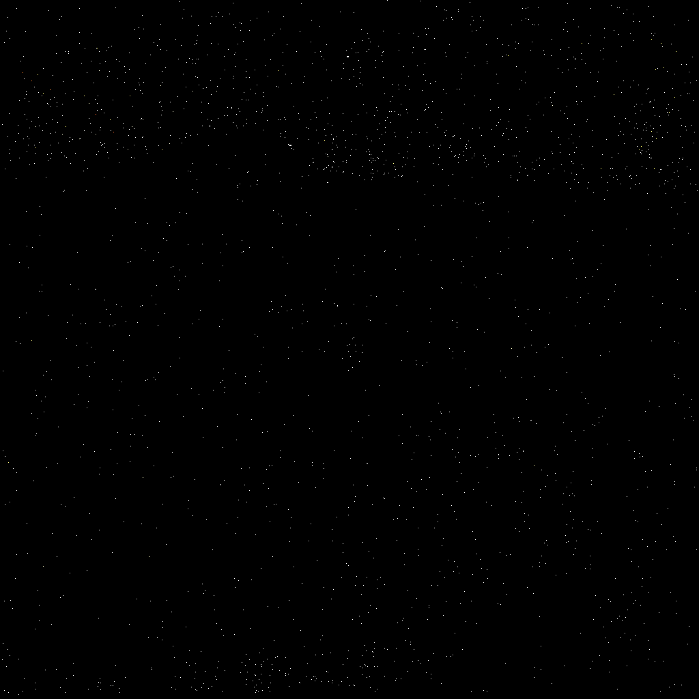<figcaption><strong>朴素 Path Tracing</strong>20 min</figcaption></figure>

<h2 id="bernstein">05Bernstein Bounds for Caustics</h2>

SIGGRAPH 2025NJU Meta Graphics · 2024.11 — 2025.02Python / C++

为焦散渲染中每个三角形组贡献的辐照度计算保守边界，只对可能产生高贡献的光路组合进行采样，缩小搜索范围。我负责将算法从原型落地为高性能 C++ 完整实现。

<figure>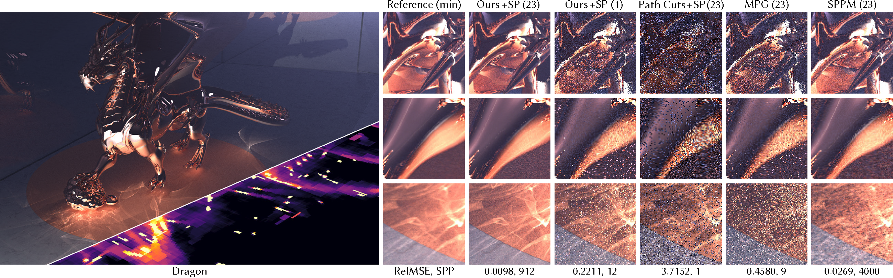<figcaption>Bernstein Bounds for Caustics / SIGGRAPH 2025</figcaption></figure>

### 渐进式实现

先用 Python 搭建 2D 原型，与密集采样逐点比对验证正确性，再迁移扩展到 C++ 的 4D 完整版本。将算法理解偏差与实现、性能问题分阶段暴露，降低复杂算法的调试成本。

<figure>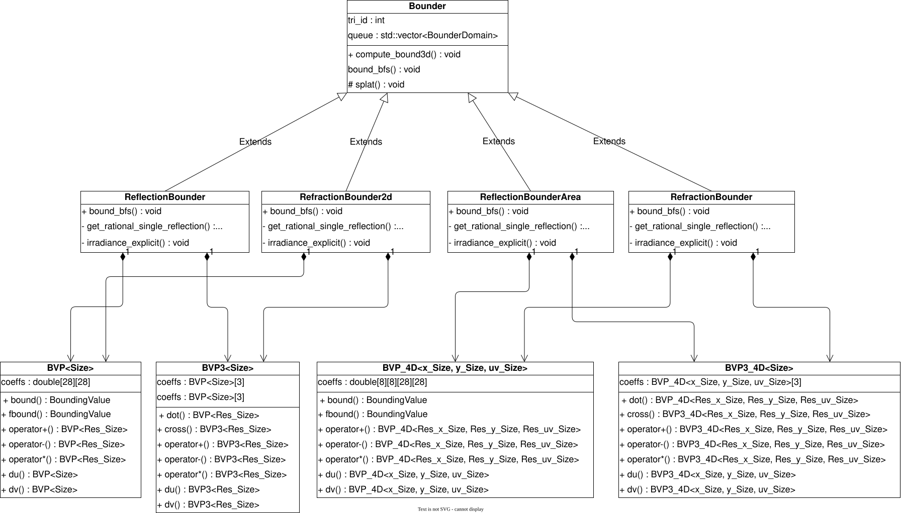<figcaption>算法实现架构 / 公共流程与多项式计算分离</figcaption></figure>

### 模板化优化

将多项式度数改为编译期固定的模板参数，使循环边界成为常量，便于编译器自动向量化；针对高频出现的低度数稀疏组合，使用模板全特化提供快路径。结合实际运算量估算理论耗时，并与实测对照检查额外实现开销。

<h2 id="unity-ssr">06Unity · Compute Shader SSR</h2>

Unity 6 / Compute Shader屏幕空间反射

在 Unity 6 渲染框架下实现 Compute Shader 版本 SSR。通过分 Tile 调度与组内共享内存复用邻域采样数据，减少重复访存并提升反射追踪效率。

<figure><video controls preload="metadata" playsinline><source src="./assets/unity-SSR.mp4" type="video/mp4"></video><figcaption>Compute Shader SSR / 屏幕空间反射展示</figcaption></figure>
